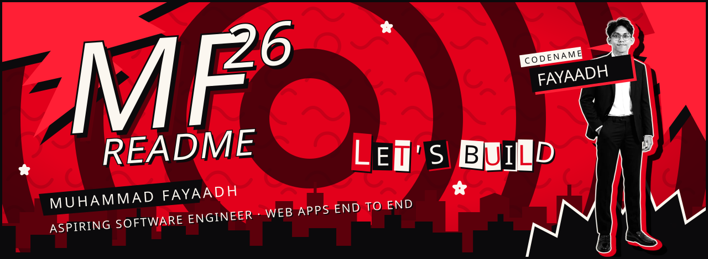
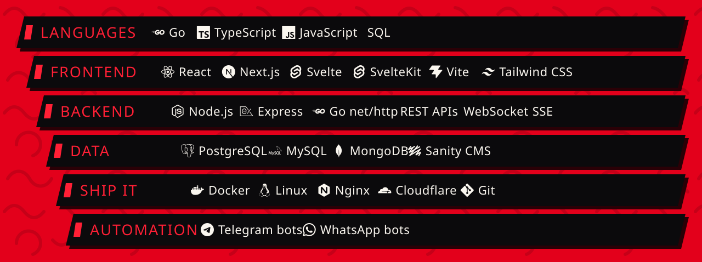
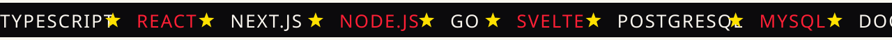

<p>
  <a href="https://www.linkedin.com/in/muhammadfayaadh/"></a>
  <a href="mailto:mfayaadhh@gmail.com"></a>
  <a href="https://mfayaadh.github.io/"></a>
  <a href="https://mfayaadh.github.io/cv.pdf"></a>
</p>

### 

```text
┌──────────────────────────── CALLING CARD ────────────────────────────┐

  To whoever is reviewing this profile,

  I build web apps end to end: interfaces in TypeScript, React and
  Next.js, APIs in Node.js and Go, data in PostgreSQL and MySQL, and
  deployment with Docker on Linux.

  I am genuinely excited about software engineering and automation —
  exploring how code can simplify everyday operations, connect
  systems, and solve real problems. Always curious and eager to learn
  new technologies, pick up unfamiliar stacks, and keep improving
  with every project I ship.

                                                  — Muhammad Fayaadh
└──────────────────────────────────────────────────────────────────────┘
```

### 



### 

| | Mission | What it is | Stack |
|:-:|---|---|---|
| ★ | **[Platform Cakap](https://cakap.biz.id/)** | WhatsApp customer-service inbox with an AI assistant that a human can take over at any moment | TypeScript · React · Node.js |
| ★ | **[SekolahRCM](https://sekolahrcm.sch.id/)** | School website and online admissions system | Next.js · Sanity · Tailwind |
| ★ | **NexusPON** | NOC dashboard for fiber networks, plus a Telegram bot for technicians | Go · Svelte · PostgreSQL |
| ★ | **[OLTuee](https://github.com/mfayaadh/oltuee)** | Open-source terminal UI for managing ZTE GPON OLTs over Telnet | Go · Bubble Tea |
| ★ | **Ledgrid** *(In Progress)* | Double-entry cloud accounting & ERP with FIFO inventory, PKP tax and bank reconciliation | Go · SvelteKit · PostgreSQL |

<sub>Most repositories are private (client and internal work). The full write-ups live on the <a href="https://mfayaadh.github.io/">portfolio</a>.</sub>

### 

- 🛠️ Building web apps with TypeScript, React / Next.js and Go
- 🚧 Actively building **Ledgrid**, an Indonesian double-entry cloud accounting & ERP platform


